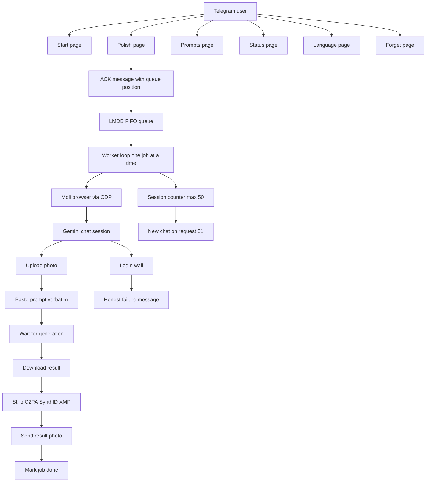

# bot-polish-image-4k

A production-ready Telegram bot built with [Gramstax](https://github.com/gramstax/gramstax): declarative pages, template-driven messages, and end-to-end tested flows.

Polish 4K polishes your photos to 4K with AI. Send a photo — on Telegram — and get a polished image back: the bot drives Gemini in a real browser session, pastes your chosen prompt verbatim, waits for the result, strips AI metadata from it, and sends it back. It works in English or Indonesian, queues polishes one at a time, shows live progress by editing its acknowledgement message, and never fakes a result when Gemini needs a login.

The generated project is Bun-only: `gramstax start`, the test suite, and the build all run on Bun.


> 🚀 **Need a custom Telegram bot?** I build Telegram bots with Gramstax — text, voice, AI agents, and integrations, tailored to your workflow. Talk to me on Telegram: [@damartripamungkas](https://t.me/damartripamungkas).

## Features

- 🖼️ **Photo polish to 4K**: send a photo, get a polished image back — driven through Gemini web in a real browser, not a fake filter
- ✨ **Prompt presets**: "4K Upscale + Colorize" (verbatim prompt, default), "4K Upscale only" (same prompt without the colorize sentence, for already-color photos), or a custom prompt you type — picked from an inline keyboard on `/prompts`
- 📨 **Immediate ACK, live progress**: the bot answers at once with your queue position, then edits that message through the stages — queued 5%, browser ready 15%, uploaded 25%, prompt sent 40%, generating 60%, downloading 85%, done 100%
- 🧵 **Sequential FIFO queue**: one polish at a time in LMDB, because there is a single Gemini session
- 🔁 **One Gemini session, 50 requests**: the same chat is reused for up to 50 polishes; the 51st starts a new chat and resets the counter — chat URL + count persist in LMDB
- 🛡️ **Metadata stripped**: every result is re-encoded and byte-scanned for C2PA, SynthID, XMP, and JUMBF markers before it is sent — a result is never sent unstripped
- 🙅 **Honest login failure**: if Gemini shows a login wall, the job fails with a clear message ("Gemini login needed — ask the owner to log in once") instead of hanging or faking a result
- 🌐 **English or Indonesian**: every message is bilingual; `/language` switches per user
- 🧪 **Mock mode for tests**: `POLISH_MOCK_AI=1` returns a deterministic copy of the input so the whole pipeline runs without a browser or login
- ✅ **E2E tested**: in-process harness asserts every Telegram API call (`e2e/` mirrors `src/pages/`)
- 🛡️ **Guards, throttling & metrics**: route guards, rate limits, and a status server out of the box

## Flow



## Quick Start

```bash
bun install
cp .env.example .env   # fill BOT_TOKEN (see Configuration)
# One-time Google login (see below) — log in once in the Moli profile
bun run dev            # gramstax start — Telegram bot (polling)
```

## One-time Google login

Status: the login driver is ready and tested
(`scripts/moli-login.mjs`, `bun run login:moli`). The bot host does not
have a logged-in profile yet — the step below still needs to be run
once by the owner.

The bot drives `gemini.google.com` in a persistent Moli browser profile.
Google needs a login once; the bot never logs in itself and never asks
for a password. The login is done with Moli + JS directly — the driver
fills the Google sign-in form in Moli (no chrome://inspect,
no DevTools screencast). Run it on a machine where you can type the
credentials into the terminal (your laptop); the password is masked,
never logged, and never stored — only the logged-in browser session
stays in the profile dir.

```bash
bun run login:moli   # prompts for Google email + password, handles 2FA
# The script verifies the login on gemini.google.com, then stops Moli.
# Zip the profile dir and place it at ./moli-profile on the bot host:
zip -r moli-profile.zip moli-profile
bun run dev   # the bot reuses that logged-in profile from now on
```

If the session ever expires, repeat the login step above. If Gemini
shows a login wall while the bot runs, the current job fails honestly
and tells the user to ask the owner to log in once.

## Commands

| Command | Description |
| --- | --- |
| `/start` | Introduction and main menu |
| `/polish` | Polish a photo to 4K |
| `/prompts` | Choose the polish prompt |
| `/status` | Show polish queue and job status |
| `/language` | Switch language (English / Indonesia) |
| `/forget` | Erase my recent polish jobs |
| `/help` | Full help and command list |

Send a photo any time (with or without `/polish`) to start a polish.
A photo caption is used as a one-off custom prompt for that job only.

## Scripts

| Script | What it does |
| --- | --- |
| `bun run dev` | Start the bot with watch mode (`gramstax start --watch`) |
| `bun run start` | Start the bot (`gramstax start`) |
| `bun run build:gramstax` | AOT build (`gramstax build`) |
| `bun run typecheck` | `tsc --noEmit` |
| `bun test test/` | Unit tests |
| `bun run test:e2e` | E2E tests (mock mode) |
| `bun run test:all` | Mirror + coverage checks, then unit + e2e tests |
| `bun run verify:moli` | Prove Bun + Playwright-core can drive Moli over CDP |
| `bun run mock:polish` | Mock pipeline end-to-end: photo in, stripped result out |

## Project Structure

```text
src/
  core/bot.ts            # BotCore: AllowList, hooks, WorkerLoop start/stop
  pages/                 # start, polish, prompts, status, language, forget, help, error
  blocks/g-keyboard.ts   # main menu + prompt picker + language picker (defined once)
  lib/
    config.ts            # POLISH_* env
    prompts.ts           # presets (verbatim default prompt) + 50-request rule
    moli.ts              # spawn/manage moli serve + CDP connect
    gemini.ts            # automate flow: goto chat, upload, paste, send, wait, download
    strip.ts             # metadata strip (sharp re-encode + byte-scan)
    progress.ts          # bilingual dynamic status texts
    photos.ts            # Telegram getFile download + mock fixture
    worker.ts            # WorkerLoop: one job at a time, ACK edits, honest failures
    lang.ts              # language resolver (en | id)
  db/
    schema/              # user (prompt prefs), job, job-queue, gemini-session
    repositories/        # user, jobs (FIFO queue), session (50-request counter)
test/                    # unit tests (59)
e2e/                     # e2e tests in mock mode (48) + COVERAGE.md ledger
scripts/
  verify-moli-cdp.ts     # Bun + playwright-core + Moli CDP proof
  mock-polish-run.ts     # mock pipeline end-to-end
  check-e2e-mirror.ts    # e2e/ mirrors src/pages/
  check-e2e-handlers.ts  # every handle* has a COVERAGE.md row
```

## Configuration

| Variable | Default | Notes |
| --- | --- | --- |
| `BOT_TOKEN` | — | Required. Telegram bot token from @BotFather |
| `MOLI_BIN` | `~/.local/bin/moli` | Path to the moli binary |
| `MOLI_PROFILE_DIR` | `./moli-profile` | Persistent Moli profile (Google login lives here) |
| `MOLI_PORT` | `9222` | CDP port Moli serves on |
| `MOLI_PROXY` | `$HTTP_PROXY` | HTTP proxy Moli must use — moli ignores proxy env vars, so the bot passes this flag explicitly |
| `GEMINI_CHAT_URL` | — | Chat URL to reuse; empty = start a new chat on first use, then store it in LMDB |
| `POLISH_JOBS_DIR` | `./jobs` | Local directory for job photos (never committed) |
| `POLISH_ALLOWED_IDS` | — | Comma-separated Telegram user IDs allowed to use the bot (empty = everyone) |
| `POLISH_MOCK_AI` | — | `1` = deterministic mock polisher (e2e tests). Never on by default |

## Testing

```bash
bun run typecheck     # tsc --noEmit — must be clean
bun run test:all      # 107 tests (59 unit + 48 e2e), mirror + coverage checks
bun run verify:moli   # spawns moli with a scratch profile, connects over CDP,
                      # reads example.com title, confirms the Gemini login wall
bun run mock:polish   # photo in -> mock result out -> strip verified, byte-scan clean
bun run build:gramstax
```

All e2e tests run in mock mode (`POLISH_MOCK_AI=1`, `DB_PATH=./data-e2e`)
— no browser, no Gemini, no Google login needed. The live Gemini flow
(upload-menu item text, send-button selector, download-button selector)
is unproven until a logged-in session exists; `src/lib/gemini.ts` marks
each selector as such and the first live run must update it with what
was actually seen.

## Deployment

Polling is the default (`bun run start`). The bot keeps one Moli
process alive for the Gemini session; if CDP drops, `MoliManager`
restarts it. `jobs/` (photos) and `moli-profile/` (login session) are
git-ignored and must be backed up with the deployment — the login
session is what keeps the bot working without re-login. Set
`POLISH_ALLOWED_IDS` to your own Telegram user id to lock the bot to
yourself.

## Tech Stack

- [Gramstax](https://github.com/gramstax/gramstax) 6.1.0 — Telegram bot framework (pages, templates, LMDB)
- [Bun](https://bun.sh) — runtime, test runner, package manager
- [Playwright-core](https://playwright.dev) 1.65.0 — drives Moli over CDP
- [Moli](https://github.com/lexmount/moli) 1.1.27 — headless browser with a persistent profile
- [sharp](https://sharp.pixelplumbing.com) — image re-encode for the metadata strip
- [@gramstax/lmdb](https://github.com/gramstax/gramstax) 6.1.0 — job queue, prompt prefs, session counter

## License

MIT — see [LICENSE](LICENSE).
